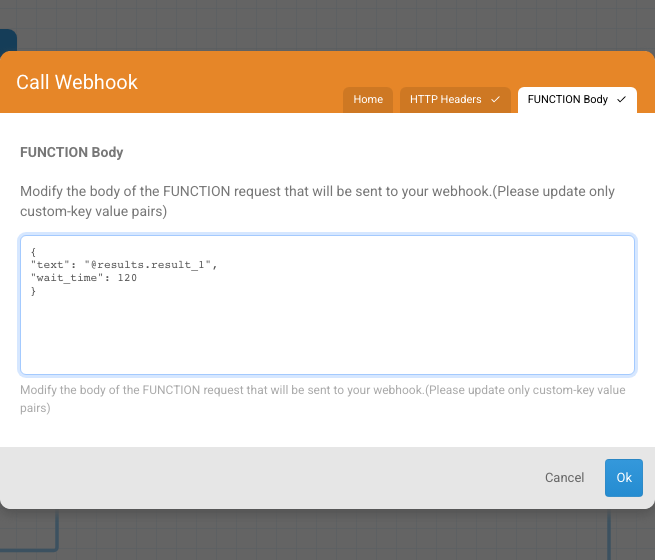
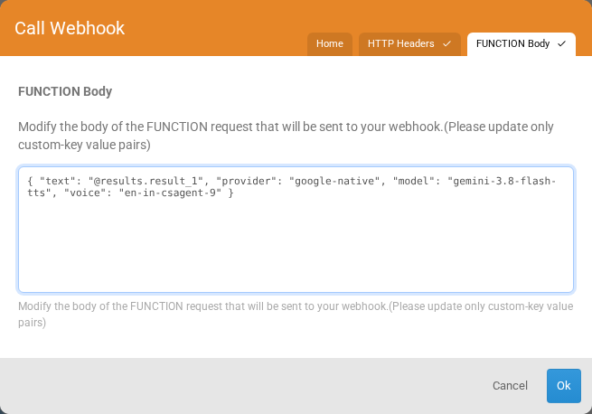

<h3>
  <table>
    <tr>
      <td><b>6 minutes read</b></td>
      <td style={{ paddingLeft: 40 }}><b>Level: Advanced</b></td>
      <td style={{ paddingLeft: 40 }}><b>Last Updated: November 2026</b></td>
    </tr>
  </table>
</h3>

# Steps to Integrate Text To Speech in Glific Flows
Text-to-Speech (TTS) function in Glific can be used to generate a voice note for any text message, whether it's typed by the end user or written by NGO staff. This allows organizations to make information more accessible, especially for end users who prefer audio over text.

#### Step 1: Create a Send Message node asking users to reply in text if they prefer.


#### Step 2: In the `Wait for Response` node, to store the response in a result  In the screenshot above, `result_1` is used as the result name.

#### Step 3: Create a `Call Webhook` node.


By default, Function would be selected. Leave this as it is.

In the Function field, select the predefined function name `text_to_speech` from the dropdown. This function calls Google's Gemini models by default for converting text to audio.


Give the webhook result name - you can use any name. In the screenshot example, it’s named `voice`.

#### Step 4: Click `Function Body` (top right corner). You would see the following.


Add the parameters as shown in the screenshot.

`text` : It should be updated with the result name given for the response/query provided by the user ex -`@results.result_1`

#### Step 5: To send the voice note via a  send Message node 


- Go to Attachments in the Send Message node
- Select `Expression` from the dropdown.
- Use the following expression: `@results.voice.message`


- Please note: To receive voice-note outputs, your Glific instance must be linked to Google Cloud Storage for your organization. This stores voice notes generated by the `text_to_speech` webhook.  

- Set up instructions: [Google Cloud Storage integration](https://glific.github.io/docs/docs/Pre%20Onboarding/Google%20Cloud%20Storage%20Setup%20-%20GCS).

## Setting the wait time for the response

Glific pauses the flow at the `text_to_speech` node while the voice note is generated, and waits **60 seconds** by default. Audio for a long message can take longer than that, and once the wait is over the flow moves ahead without the voice note.

To wait longer, add a `wait_time` parameter, in **seconds**, to the `Function Body`.



The maximum is 300 seconds (5 minutes). Leave it blank and the default of 60 seconds applies. Read more in [Call a webhook](https://glific.github.io/docs/docs/Product%20Features/Flows/Flow%20Actions/Call%20a%20webhook/#wait-time-for-ai-function-webhooks).

#### Default parameters for text_to_speech node 
When only the `text` parameter is passed, the following default values of model and voice are used 

- model: gemini-3.8-flash-lite-tts (Google)
- voice: en-in-csagent-9


## Variations in model and voice parameters 

Within Google Gemini's text to speech capabilities, following are the available alternatives for model and voice configurations


### Google (Gemini) TTS Models

**Provider Name**: `google-native`

| Model Name | Description | 
|---|---|
| `gemini-3.8-flash-lite-tts` (Default) | Fastest, most lightweight model | 
| `gemini-3.8-flash-tts` | Higher quality flash model with richer voice naturalness | 

:::note
Google retired `gemini-2.5-pro-preview-tts`, `gemini-2.5-flash-preview-tts` and `gemini-3.1-flash-tts-preview` on November 17, 2026. A flow that still names one of these older models no longer errors — it automatically uses the default model instead.
:::

### Google (Gemini) Voices

Glific defaults to the `en-in-csagent-9` voice. A different voice can be used by passing its exact name through the `voice` parameter.

Here are voice suggestions for some of the supported languages:

| Language | Voice Name | Characteristics | Gender | Best For |
|---|---|---|---|---|
| English (India) | `en-in-csagent-9` (Default) | Light, airy, precise | Female | General purpose, support messages |
| English (India) | `en-in-csagent-1` | Natural, clear | Male | General purpose, support messages |
| Hindi | `hi-in-csagent-4` | Crisp, eager | Female | Welfare and outreach updates |
| Hindi | `hi-in-csagent-11` | Crisp, eager | Male | Welfare and outreach updates |
| Bengali | `bn-in-assistant-1` | Conversational, casual | Female | Community and family messages |
| Bengali | `bn-in-podcaster-1` | Conversational, natural | Male | News-style or informational updates |
| Tamil | `ta-in-csagent-6` | Textured, resonant, soothing | Female | Helpline and support messages |
| Tamil | `ta-in-csagent-2` | Natural, clear | Male | Helpline and support messages |
| Telugu | `te-in-csagent-5` | Warm, engaging | Female | Outreach and awareness messages |
| Telugu | `te-in-csagent-4` | Textured, resonant, soothing | Male | Outreach and awareness messages |
| Gujarati | `gu-in-techagent-1` | Soft, polite, clear | Female | Guidance and advisory messages |
| Gujarati | `gu-in-concierge-1` | Warm, hearty, approachable | Male | Guidance and advisory messages |
| Marathi | `mr-in-assistant-1` | Energetic, colorful, fast | Female | Lively community updates |
| Marathi | `mr-in-assistant-2` | Laid-back, encouraging, chill | Male | Lively community updates |

Google Gemini provides many more prebuilt voices across accents and personas for these languages. Any voice name from the catalog can be passed through the `voice` parameter.

Models and voices can be overridden from the webhook by explicitly passing additional parameters, for example:

```
"provider" : "google-native",
"model" : "gemini-3.8-flash-tts",
"voice" : "en-in-csagent-9"
```
Please note: **`provider` and `model` must always be specified together.** If only one of the two is set, the webhook returns an error.



Here, the `model` can be set to any value from the table above, and the `voice` to any supported voice name.


#### Supported Languages

- English
- Hindi
- Bengali
- Tamil
- Telugu
- Marathi
- Gujarati
- Kannada
- Malayalam
- Punjabi 
- Odia (works best with elevenlabs)
- Sindhi 

## Using other providers 
It is possible to use ElevenLabs, Sarvam and other providers, through this webhook instead of Google Gemini, if the organization has acquired credits from any of these providers. Reach out to the Glific team at support@glific.org to know more.
